# NodeScope Architecture

## Component Architecture

```mermaid
graph TB
    App["App.tsx<br/>(State: endpoint, profile,<br/>history, healthSnapshots,<br/>connected flag)"]
    
    Layout["Layout Components"]
    Header["Header<br/>(Branding, status badge)"]
    Sidebar["Sidebar<br/>(Navigation)"]
    
    Dashboard["Dashboard Section"]
    Overview["Overview<br/>(Connection status,<br/>latest metrics)"]
    HealthCheckPanel["HealthCheckPanel<br/>(Run Health Check button,<br/>latest snapshot display)"]
    SnapshotComparison["SnapshotComparison<br/>(Snapshot A/B selector,<br/>comparison diff)"]
    
    Diagnostics["Diagnostics Section"]
    RpcConsole["RpcConsole<br/>(Method presets,<br/>raw RPC testing)"]
    CapabilityDiscovery["CapabilityDiscoveryPanel<br/>(Advertised vs tested<br/>methods)"]
    DiagnosticReport["DiagnosticReport<br/>(Export to JSON)"]
    
    Metrics["Metrics Section"]
    NodeMetricsInspector["NodeMetricsInspector<br/>(Block height, latency,<br/>peer count)"]
    
    Services["Services Layer"]
    RpcClient["rpcClient<br/>(sendJsonRpcRequest)"]
    HealthCheckRunner["healthCheckRunner<br/>(runHealthCheck,<br/>methodsForProfile)"]
    HealthSnapshotStorage["healthSnapshotStorage<br/>(getHealthSnapshots,<br/>saveHealthSnapshot)"]
    DiagnosticRules["diagnosticRules<br/>(evaluateHistoryFindings,<br/>deduplicateFindings)"]
    ConnectionTester["connectionTester<br/>(testEndpointConnection)"]
    CapabilityDiscoverySvc["capabilityDiscovery<br/>(discoverMethods)"]
    
    Utils["Utils Layer"]
    SnapshotComparer["snapshotComparer<br/>(compareSnapshots)"]
    ReportBuilder["reportBuilder<br/>(buildDiagnosticReport)"]
    ChainIdValidator["chainIdValidator<br/>(validatePortaldotV3ChainId)"]
    UrlValidator["urlValidator<br/>(validateAndSanitize)"]
    CapabilityEvidence["capabilityEvidence<br/>(getMethodEvidenceStatus)"]
    MetricParsers["metricParsers<br/>(parseBlockHeight,<br/>parseLatency)"]
    
    Storage["Storage Layer"]
    SessionStorage["sessionStorage<br/>(history: max 50 items)<br/>(snapshots: max 20 items)"]
    
    RPC["RPC Target"]
    Portaldot["Portaldot V3.0 EVM<br/>test-evm-rpc-v3.portaldot.dev<br/>Chain ID: 420420777"]
    
    App --> Layout
    Layout --> Header
    Layout --> Sidebar
    Layout --> Dashboard
    Layout --> Diagnostics
    Layout --> Metrics
    
    Dashboard --> Overview
    Dashboard --> HealthCheckPanel
    Dashboard --> SnapshotComparison
    
    Diagnostics --> RpcConsole
    Diagnostics --> CapabilityDiscovery
    Diagnostics --> DiagnosticReport
    
    Metrics --> NodeMetricsInspector
    
    HealthCheckPanel --> HealthCheckRunner
    SnapshotComparison --> SnapshotComparer
    RpcConsole --> RpcClient
    CapabilityDiscovery --> CapabilityDiscoverySvc
    DiagnosticReport --> ReportBuilder
    NodeMetricsInspector --> MetricParsers
    Overview --> ConnectionTester
    
    HealthCheckRunner --> RpcClient
    HealthCheckRunner --> DiagnosticRules
    HealthCheckRunner --> ChainIdValidator
    HealthCheckRunner --> HealthSnapshotStorage
    
    DiagnosticRules --> CapabilityEvidence
    
    ConnectionTester --> RpcClient
    ConnectionTester --> ChainIdValidator
    
    CapabilityDiscoverySvc --> RpcClient
    CapabilityDiscoverySvc --> CapabilityEvidence
    
    ReportBuilder --> UrlValidator
    
    HealthSnapshotStorage --> SessionStorage
    
    RpcClient --> Portaldot
    RpcConsole --> Portaldot
    
    style App fill:#1e3a8a
    style Services fill:#0c4a6e
    style Utils fill:#0f766e
    style Storage fill:#5a21b5
    style RPC fill:#7c2d12
```



## Data Flow

### Health Check Snapshot Run

1. **User clicks "Run Health Check" button** in `HealthCheckPanel`
2. **`HealthCheckRunner.runHealthCheck(endpoint, profile)`** orchestrates:
   - Determines methods based on profile (`portaldot_v3_evm` vs `generic_http`)
   - For each method, calls `rpcClient.sendJsonRpcRequest(endpoint, method, [], timeoutMs)`
   - Classifies each result: outcome type (success, unsupported_method, rpc_error, network_error, http_error, invalid_response), observed value, latency
   - Runs diagnostic rules: `diagnosticRules.evaluateChainIdValidation()`, `evaluateDiagnosticResult()`, `evaluateLatencyThreshold()`
   - Deduplicates findings: `diagnosticRules.deduplicateFindings(rawFindings)`
3. **Returns `HealthCheckSnapshot`** with:
   - Snapshot ID (unique per run)
   - Timestamp (milliseconds, ISO string)
   - Endpoint origin (sanitized)
   - Endpoint profile (portaldot_v3_evm or generic_http)
   - Checks array (method outcomes, latency, observed values)
   - Findings array (deduplicated diagnostic findings)
4. **`App.tsx` calls `healthSnapshotStorage.saveHealthSnapshot(snapshot)`**:
   - Validates snapshot schema
   - Prepends to existing snapshots in sessionStorage
   - Keeps max 20 snapshots, discards oldest
   - Returns updated snapshots array
5. **`App.tsx` updates state**, triggering re-render
6. **`HealthCheckPanel` displays latest snapshot** with individual check results and findings

### Snapshot Comparison

1. **User selects two snapshots (A, B)** in `SnapshotComparison` component
2. **Calls `snapshotComparer.compareSnapshots(snapshotA, snapshotB)`**:
   - Checks compatibility (same endpoint/profile = like-for-like; different = cross-endpoint)
   - Matches checks by method name
   - Classifies each check: unchanged, changed, added, removed
   - Compares outcomes, success flags, observed values, latency
   - Derives block-height delta if both snapshots have valid block height (e.g., from eth_blockNumber)
   - Matches findings by `ruleId::normalizedEvidence` key
   - Classifies findings: new_finding, resolved_finding, unchanged_finding
3. **Returns `SnapshotComparison` object** with:
   - Metadata (snapshotA, snapshotB, comparable flag, incompatibility reason)
   - comparedChecks array (method, status, outcome change, observed value change, latency delta)
   - comparedFindings array (finding, status, new or resolved rule details)
   - blockHeightDelta (decimal string value, or unavailable status/reason)
4. **`SnapshotComparison` component renders**:
   - Compatibility warning (if cross-endpoint)
   - Block height delta (e.g., "+6 blocks")
   - Checks table (method, status badge, changes)
   - Findings list (grouped by new/resolved/unchanged, with ruleId, severity, title)

### Report Export

1. **User clicks "Export Report" button** in `DiagnosticReport` component
2. **`reportBuilder.buildDiagnosticReport(history, findings?)`** builds:
   - Schema version: `nodescope.diagnostic-report.v1`
   - Export timestamp (ISO string)
   - Record count (length of raw history)
   - Records array (each diagnostic history item with sanitized endpoint)
   - Findings array (optional, deduplicated)
3. **Export generates JSON Blob and triggers download**:
   - Filename: `nodescope-report-{timestamp}.json`
   - File saves to user's Downloads folder (browser default)
4. **User retains JSON file** for archival, sharing, or cross-referencing with other tools

## Key Data Structures

### Health Check Snapshot

```typescript
interface HealthCheckSnapshot {
  schemaVersion: 'nodescope.health-snapshot.v1'
  id: string                          // "health-${timestamp}-${random}"
  timestamp: number                   // milliseconds since epoch
  exportedAt: string                  // ISO 8601 timestamp
  endpointOrigin: string              // sanitized: https://example.com
  endpointProfile: EndpointProfile    // "portaldot_v3_evm" | "generic_http"
  checks: HealthCheckCheck[]          // individual RPC method results
  findings: Finding[]                 // deduplicated diagnostic findings
}

interface HealthCheckCheck {
  method: string                      // e.g., "eth_chainId"
  outcome: HealthCheckOutcome         // "success" | "unsupported_method" | "rpc_error" | ...
  success: boolean                    // outcome === "success"
  latencyMs: number | null            // RPC round-trip time
  observedValue: string | number | null  // e.g., "0x190f1ca9" or 420420777 or null
  error: string | null                // error message if failure
}

interface Finding {
  ruleId: string                      // e.g., "chain-id-verified"
  severity: "info" | "warning" | "error"
  title: string                       // user-friendly title
  evidence: string                    // what was observed
  explanation: string                 // why this matters
  recommendation: string              // suggested action
}
```

### Snapshot Comparison Result

```typescript
interface SnapshotComparison {
  snapshotA: HealthCheckSnapshot
  snapshotB: HealthCheckSnapshot
  comparable: boolean                 // true if same endpoint/profile
  incompatibilityReason?: string      // e.g., "Cross-endpoint comparison"
  comparedChecks: ComparedCheck[]
  comparedFindings: ComparedFinding[]
  blockHeightDelta?: BlockHeightDelta
}

interface ComparedCheck {
  method: string
  status: "unchanged" | "changed" | "added" | "removed"
  outcomeA?: HealthCheckOutcome
  outcomeB?: HealthCheckOutcome
  observedValueA?: string | number | null
  observedValueB?: string | number | null
  latencyDelta?: number | null        // B latency - A latency (if both available)
}

interface ComparedFinding {
  ruleId: string
  status: "new_finding" | "resolved_finding" | "unchanged_finding"
  finding: Finding
}

interface BlockHeightDelta {
  value?: string                      // decimal string if available
  status: "success" | "unavailable" | "unsupported" | "invalid"
  reason?: string
}
```

### Diagnostic Report Export

```typescript
interface DiagnosticReportExport {
  schemaVersion: "nodescope.diagnostic-report.v1"
  exportedAt: string                  // ISO 8601
  recordCount: number                 // total raw history items
  records: DiagnosticReportEntry[]    // one per history item
  findings?: Finding[]                // optional, deduplicated
}

interface DiagnosticReportEntry {
  method: string
  outcome: string
  latency: number | null
  observedValue?: string | number | null
  endpointOrigin: string
  evidence: string
  error?: string
}
```

## Storage Backend

### sessionStorage Layout

**Key 1: `nodescope_rpc_history_v1`**
- Stores raw RPC diagnostic history (max 50 items)
- Used by `historyStorage.ts` for general RPC diagnostics

**Key 2: `nodescope_health_snapshots_v1`**
- Stores health check snapshots (max 20 items)
- Used by `healthSnapshotStorage.ts`
- Each snapshot includes full checks + findings

**Persistence Notes:**
- Both keys cleared on tab close or browser exit
- Snapshots and history are independent; export to JSON for long-term storage
- SessionStorage is browser-local (not synced across tabs)
- Max capacity ~5–10MB per domain depending on browser

## Endpoint Profile Strategies

### `portaldot_v3_evm` Profile

**Methods Called:**
- `eth_chainId` — validates chain ID against 420420777
- `eth_blockNumber` — retrieves current block height
- `web3_clientVersion` — client version string
- `net_version` — network identifier

**Substrate Methods (NOT called on EVM profile):**
- `system_health` → expected to return -32601 if accidentally called
- `system_version` → expected to return -32601 if accidentally called
- `chain_getHeader` → expected to return -32601 if accidentally called

**Rationale:** EVM endpoint supports only EVM methods; Substrate methods are only on Substrate HTTP endpoints.

### `generic_http` Profile

**Methods Called:**
- `system_health` — node health status
- `system_version` — node version
- `chain_getHeader` — block header (Substrate)
- `eth_chainId` — fallback (may not be supported)

**Use Case:** Generic Substrate HTTP endpoints, local nodes, or compatibility testing.

## Error Classification

NodeScope distinguishes between:

1. **`network_error`** — transport failures (CORS, timeout, DNS, connection refused)
2. **`http_error`** — HTTP layer failures (4xx, 5xx status codes)
3. **`unsupported_method` (-32601)** — valid JSON-RPC error, method not found
4. **`rpc_error`** — other JSON-RPC errors (-32700, -32600, -32603, etc.)
5. **`invalid_response`** — malformed JSON, missing `result` field, etc.
6. **`success`** — valid RPC response

This granularity allows users to distinguish a misconfiguration (unsupported method on wrong profile) from a transient network issue.

## Future Extensibility

### Planned Additions (Not Yet Implemented)

- **WebSocket support** — for Substrate WebSocket endpoint `wss://test-node-v3.portaldot.dev`
- **Trends / Historical Analysis** — latency trend, block height velocity
- **Automated polling** — optional background health checks (user-configurable interval)
- **Contract inspection** — read smart contract state via eth_call (view-only)
- **Custom method definitions** — allow users to define RPC methods not in presets

All additions will preserve the current immutable-first design and test-driven approach.
